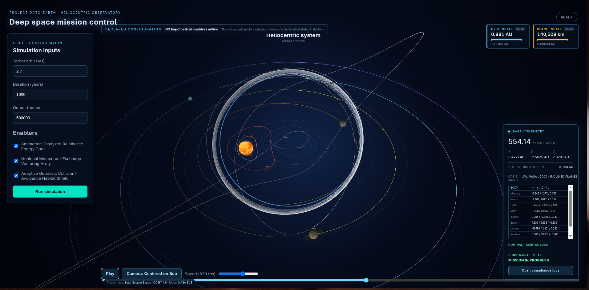

# Octo-Earth planetary propulsion simulation

## Project Scope and Details
This is the simulaton and visualization of the octo-earth concept that tries to think of a concept to move
earth into a different orbit. The details is mentioned cleanly in [docs](./docs).

## Credits

Planetary initial states use the NASA/JPL approximate orbital elements at the
J2000.0 epoch, including eccentricity, inclination, longitude of ascending
node, longitude of perihelion, and mean longitude. The visualizer preserves
the resulting three-dimensional planes rather than flattening all ellipses
onto one screen plane. Reference: [NASA planetary orbital elements](https://ssd.jpl.nasa.gov/planets/approx_pos.html).

The browser scene bundles equirectangular planet and atmosphere maps from
[Solar System Scope](https://www.solarsystemscope.com/textures/), licensed
under [CC BY 4.0](https://creativecommons.org/licenses/by/4.0/), and the Moon
color map from NASA's [CGI Moon Kit](https://svs.gsfc.nasa.gov/4720/). The
maps load locally at runtime, so the visualization does not depend on an
external image server. Required credits and source notes are in
`frontend-web/public/textures/planets/ATTRIBUTION.txt`.

The scene also shows a visualization-only eight-arm segmented ring around
Earth, mounted at a 7,000 km radius with arm tips at approximately 72,000 km
from Earth's center, and a Moon revolving around Earth. Celestial display
distances and sizes are enlarged for visibility; this visual assembly does not
change or validate the simulation's physical model or Earth trajectory.

## Declared hypothetical enablers

The current prototype exposes **three** bounded enablers, matching the
participant guide limit:

1. **Antimatter-Catalyzed Relativistic Energy Core (ACREC)**: controlled
   matter-antimatter annihilation supplies the computed orbital energy budget;
   fuel mass and power are reported in the audit.
2. **Nonlocal Momentum-Exchange Vectoring Array (NMEVA)**: a declared
   reaction path couples the propulsion impulse to an external momentum
   reservoir, so the thrust has an equal/opposite reaction ledger outside the
   Earth system.
3. **Adaptive Geodesic Collision-Avoidance Habitat Shield (AGCAHS)**: an
   assumed field-and-material envelope preserves structural margin,
   atmosphere, magnetic shielding, and climate. ACREC-powered orbital
   refractors/mirrors deliver the missing heat at 2.7 AU while AGCAHS
   distributes it and limits atmospheric loss.

With all three enabled, the assumed energy source, reaction path, and habitat
system are active and the modeled 10,000-year mission can pass. With
ACREC disabled the target journey is incomplete; with NMEVA disabled the
structure/momentum gate fails; with AGCAHS disabled the thermal/structural and
collision gates fail. At 2.7 AU the audit computes about `1.2 kW/m²` of
additional incident heat and `2.2e17 W` delivered climate power for a 288 K
surface under a 255 K effective-radiating greenhouse envelope. These are explicit
simulation assumptions, not claims about present-day engineering.

## Validation status

The automated suite includes the core smoke tests, long-horizon orbit checks,
the 10,000-year enabled run, and the guide's first three electromagnetic
benchmarks (wire force, closed-loop cancellation, and long-wire field).
The audit executable and browser archive now calculate the conservation,
angular-momentum, energy, climate, Moon-boundness, collision, convergence,
transfer, and structural records from the simulation state and closed-form
benchmark equations. The UI reports the resulting measured rulebook verdict.

## Separate compliance logs

Each browser simulation generates a fresh audit bundle in memory from the same
world telemetry run. The in-simulation **Open compliance logs** control
downloads it as `octo-compliance-logs.zip`; the archive contains separate CSV
files for validation benchmarks, conservation, angular momentum, habitability,
timestep convergence, and collision checking. Generated files are ignored by
Git. Every downloaded row is either measured from the
simulation or derived from a named benchmark equation.

## Technical documentation

The report is split into focused modules so that the assumptions, equations,
implementation, and evidence can be reviewed independently:

- [Documentation index](docs/README.md)
- [Initial conditions and system architecture](docs/architecture.md)
- [Enabler declarations and bounded behavior](docs/enablers.md)
- [Physics, equations, and numerical method](docs/physics.md)
- [Feasibility, violated practical principles, and interpretation](docs/feasibility.md)
- [Running the project and reading its logs](docs/operations.md)

## How the visualization looks

## Developers (Team `Ken Thompson`)
- Raj: [eremognosis](https://github.com/eremognosis)
- Mayank: [Mayank637-pixel](https://github.com/Mayank637-pixel)
- Tabish: [tabish1538](https://github.com/tabish1538)
- Abhishek: [TriConty](https://github.com/TriConty)
- Joseph: [Joseph-git486](https://github.com/Joseph-git486)

Built during the 42 hour [Transfinitte](https://transfinitte.org) hackathon window for the problem statement
supplied by [Black Ant Robotics](https://www.blackantrobotics.com/) by team `Ken Thompson` named after the Turing Award Winner, legend Ken Thompson.

## License
[GPL-v3](./LICENSE)
